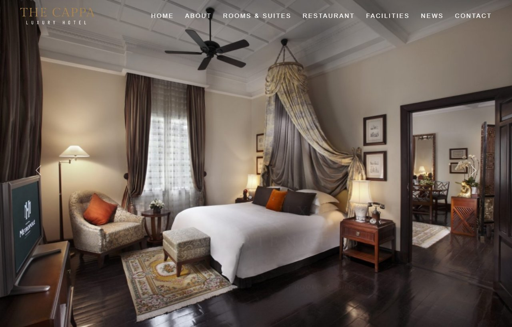
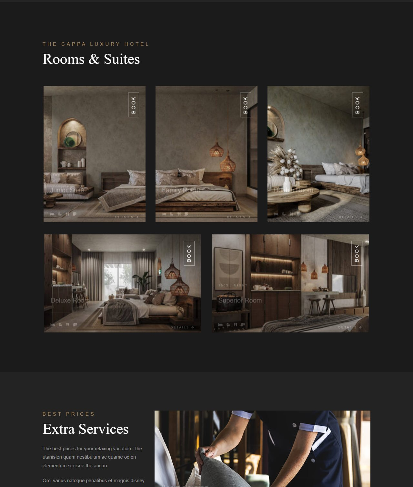
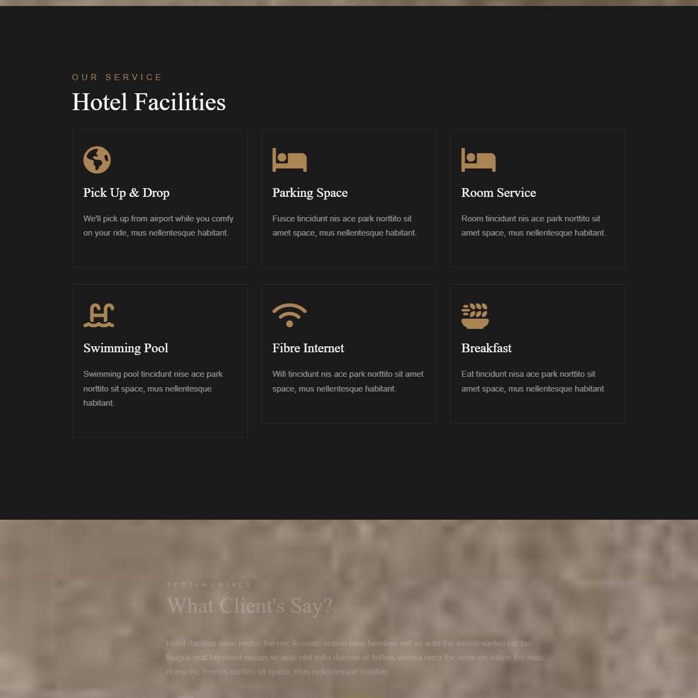
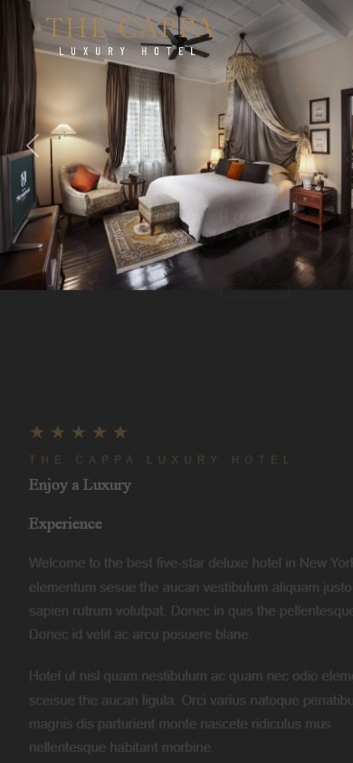

# 🏨 The Cappa — Luxury Hotel & Resort

เว็บไซต์โรงแรมหรู (Landing Page) ดีไซน์สไตล์ luxury โทนสีเข้ม–ทอง พร้อม carousel, ฟอร์มจองห้อง, รีวิวลูกค้า และ responsive รองรับมือถือ

🔗 **Live Demo:** https://piyachai3671.github.io/DesignHotel/

<p align="center">
  
</p>

---

## 📸 ตัวอย่างหน้าเว็บ

### Rooms & Suites
<p align="center">
  
</p>

### Hotel Facilities
<p align="center">
  
</p>

### 📱 Responsive (มือถือ)
<p align="center">
  
</p>

---

## 🚀 วิธีเปิดดู

เปิดได้ทันทีโดยไม่ต้องติดตั้งอะไรเลย — เลือกได้ตามต้องการ:

| ไฟล์ | ลักษณะ | เหมาะกับ |
|------|--------|----------|
| [`public/index-offline.html`](public/index-offline.html) | **ออฟไลน์ 100%** — ฝังรูปภาพ, Bootstrap, Font Awesome, ฟอนต์ และ JS ไว้ในไฟล์เดียวทั้งหมด | เปิดที่ไหนก็ได้ ไม่ต้องต่อเน็ต ไม่ต้องมีโฟลเดอร์ข้างนอก ✅ |
| [`public/index-standalone.html`](public/index-standalone.html) | รูปภาพฝังในไฟล์ แต่ CSS/JS โหลดจาก CDN | พกพาง่าย แต่ต้องต่อเน็ต |
| [`public/index.html`](public/index.html) | อ้างอิงโฟลเดอร์ `public/img/` และ `public/css/` ภายนอก | ใช้ตอนวางในโฟลเดอร์ `public/` ครบชุด |

**แนะนำ:** ดับเบิลคลิก [`public/index-offline.html`](public/index-offline.html) เปิดในเบราว์เซอร์ได้เลย

> 💡 ปุ่มเล่นวิดีโอโปรโมตจะทำงานเมื่อมีไฟล์ `public/img/video.mp4` อยู่ในโฟลเดอร์ (ไฟล์ใหญ่จึงไม่ได้ฝังเข้าไป)

---

## ✨ ฟีเจอร์

- 🎠 Hero carousel สไลด์ภาพอัตโนมัติ พร้อมข้อความ fade-in
- 🛏️ ส่วน Rooms & Suites พร้อมเอฟเฟกต์ hover zoom
- 🧖 Extra Services / Spa / Restaurant / Fitness
- 🏊 Hotel Facilities (6 บริการ)
- 💬 รีวิวลูกค้า (Testimonials) แบบ carousel
- 📰 Our News / Blog
- 📅 ฟอร์มจองห้อง (Booking Form)
- 📱 Responsive — มีเมนู hamburger สำหรับมือถือ
- 🔤 ฟอนต์ Gilda Display, Barlow, Barlow Condensed

---

## 🛠️ เทคโนโลยี

- **HTML5 / CSS3** (CSS animations, flexbox, media queries)
- **Bootstrap 5.2.2** — grid, carousel, modal
- **Font Awesome 6.1.1** — ไอคอน
- **jQuery 3.6.0** — เอฟเฟกต์ข้อความและเมนู
- ต้นฉบับพัฒนาบน **Laravel 10** (Blade templates) — ดูเอกสาร framework เดิมได้ที่ [`README.laravel.md`](README.laravel.md)

---

## 📂 โครงสร้างไฟล์หลัก

```
public/
├── index-offline.html      ← ออฟไลน์ 100% (แนะนำ)
├── index-standalone.html   ← รูปฝังในไฟล์ (CSS/JS จาก CDN)
├── index.html              ← ต้องอยู่คู่กับ img/ และ css/
├── img/                    ← รูปภาพต้นฉบับ
└── css/main.css
resources/views/            ← Blade templates ต้นฉบับ (Laravel)
screenshots/                ← ภาพประกอบ README
```
